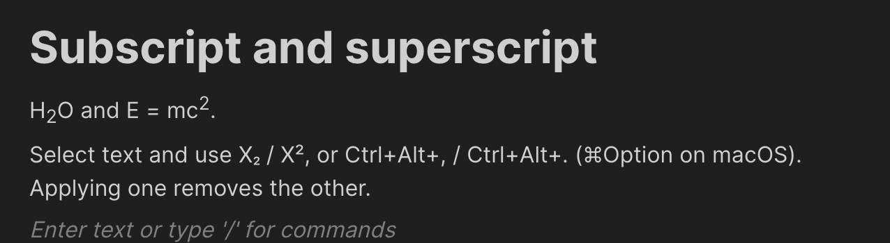

# BlockNote subscript and superscript

A small BlockNote plugin that adds semantic `subscript` and `superscript`
styles, along with formatting-toolbar buttons. It exports styled content as
native `<sub>` and `<sup>` elements and recognises those elements when HTML is
pasted into the editor.

## Example


## Install

```sh
npm install @defensestation/blocknote-subscript-superscript
```

## Use

Add the supplied style specs to the schema, then add the two buttons to a
custom formatting toolbar. The `editor` prop is deliberately inferred from
your schema, so style methods remain type-safe.

```tsx
import { BlockNoteSchema, defaultStyleSpecs } from "@blocknote/core";
import { BlockNoteView } from "@blocknote/mantine";
import {
  BasicTextStyleButton,
  FormattingToolbar,
  FormattingToolbarController,
  useCreateBlockNote,
} from "@blocknote/react";
import {
  SubscriptButton,
  SuperscriptButton,
  createSubscriptSuperscriptShortcuts,
  subscriptSuperscriptStyleSpecs,
} from "@defensestation/blocknote-subscript-superscript";

const schema = BlockNoteSchema.create({
  styleSpecs: {
    ...defaultStyleSpecs,
    ...subscriptSuperscriptStyleSpecs,
  },
});

function Editor() {
  const editor = useCreateBlockNote({
    schema,
    extensions: [
      createSubscriptSuperscriptShortcuts({
        // Avoid ⌘, which commonly opens application settings on macOS.
        subscript: "Mod-Alt-,",
        superscript: "Mod-Alt-.",
      }),
    ],
  });

  return (
    <BlockNoteView editor={editor} formattingToolbar={false}>
      <FormattingToolbarController
        formattingToolbar={() => (
          <FormattingToolbar>
            <BasicTextStyleButton basicTextStyle="bold" />
            <BasicTextStyleButton basicTextStyle="italic" />
            <SubscriptButton editor={editor} />
            <SuperscriptButton editor={editor} />
          </FormattingToolbar>
        )}
      />
    </BlockNoteView>
  );
}
```

`toggleSubscriptSuperscript(editor, "subscript")` and
`toggleSubscriptSuperscript(editor, "superscript")` are also exported for
custom menus or keyboard shortcuts. Toggling either style removes the other.

## Keyboard shortcuts

Use `createSubscriptSuperscriptShortcuts` to select the key combinations your
application can safely reserve. `Mod` means Command on macOS and Control on
Windows/Linux. The example above uses `Mod-Alt-,` and `Mod-Alt-.` to avoid the
common macOS `⌘,` settings shortcut.

The `subscriptSuperscriptShortcuts` export uses those macOS-safe defaults when
you do not need custom bindings: `Mod-Alt-,` for subscript and `Mod-Alt-.` for
superscript. Disable either binding with `false`:

```ts
createSubscriptSuperscriptShortcuts({
  subscript: false,
  superscript: "Mod-Alt-.",
});
```

## Publishing

Pushes to `main` publish the version in `package.json` with npm's `latest`
tag. Bump that version before a release; the workflow skips versions that are
already published. Pushes to `dev` publish an isolated prerelease such as
`0.1.0-dev.42` under npm's `dev` tag.

Configure npm trusted publishing for this GitHub repository, or add an
`NPM_TOKEN` repository secret with permission to publish this package.

## Local Vite development

The published package uses peer dependencies, so a normal install shares the
host application's React and BlockNote runtimes. If you use `npm link` or a
`file:` dependency while developing with Vite, configure Vite to deduplicate
them; otherwise Vite can resolve a second React or Yjs copy from the linked
package:

```ts
// vite.config.ts
import { defineConfig } from "vite";

export default defineConfig({
  resolve: {
    dedupe: [
      "react",
      "react-dom",
      "@blocknote/core",
      "@blocknote/react",
      "yjs",
    ],
  },
});
```
